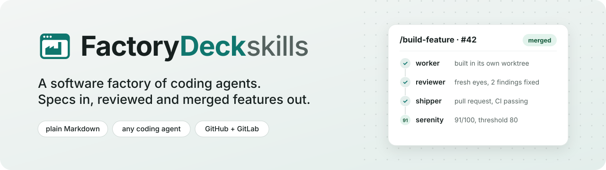

<p align="center">
  <picture>
    <source media="(prefers-color-scheme: dark)" srcset="docs/assets/banner-dark.svg" />
    
  </picture>
</p>

<p align="center">
  <a href="LICENSE"></a>
  
  <a href="https://agentskills.io"></a>
  <a href="https://github.com/CGSeb/factorydeck"></a>
</p>

<p align="center">
  <a href="#the-skills">The skills</a> ·
  <a href="#install">Install</a> ·
  <a href="#watch-it-run-with-factorydeck">FactoryDeck</a> ·
  <a href="docs/configuration.md">Configuration</a> ·
  <a href="docs/guardrails.md">Guardrails</a>
</p>

<picture>
  <source media="(prefers-color-scheme: dark)" srcset="docs/assets/workflow-dark.svg" />
  
</picture>

**FactoryDeck skills turn your coding agent into a software factory.** You write a spec with it; the factory settles its open questions, builds it in its own worktree, has it reviewed by a fresh agent, scores how safe it is to merge, and merges it or hands it to you. After each run, a retro makes the next one better.

- **Plain Markdown.** The skills call `git` and your git host's CLI, nothing else: no Node, no Python, no Docker, nothing to build. They work in any language, on any stack.
- **Any coding agent.** Claude Code, Codex, GitHub Copilot, Gemini CLI and every agent that reads [Agent Skills](https://agentskills.io).
- **GitHub or GitLab.** Every host command lives in one file, checked against your installed CLI.
- **Hard limits, not promises.** Branch protection, agent permissions and a merge gate keep a person in the loop where it matters. See [Guardrails](docs/guardrails.md).

> [!NOTE]
> Early days. Used daily with Claude Code on GitHub; Codex, Copilot and GitLab follow the same files but have had less use. Reports welcome.

## The skills

|                                      |                                                                                                                                                       |
| ------------------------------------ | ----------------------------------------------------------------------------------------------------------------------------------------------------- |
| 🧰 **`setup-factory`**               | Run once. Asks you, one section at a time, for your git host, coding agents, spec format, labels, check command and merge policy, and writes them to `docs/agents/`. |
| ✍️ **`write-spec`**                  | Interviews you on a feature, writes a spec (a file or the issue itself) with testable criteria, and opens its issue with its dependencies.                           |
| 🔍 **`check-spec`**                  | Finds every product choice a spec leaves open and gets it settled, with you or as questions on the issue.                                            |
| 🏭 **`build-feature`**               | The orchestrator. One background worker per buildable issue, a fresh reviewer before any push, a cheaper shipper for the pull request and CI, then gates and a serenity score decide: merge, or you. |
| 🧪 **`create-verification-skill`**   | Generates `verify-<app>`, a project skill that drives your app like a user and keeps evidence. Workers use it to prove each criterion.                |
| 🗺️ **`maintain-verification-skill`** | Keeps that skill's feature map honest as the app changes.                                                                                            |
| 🔁 **`retro`**                       | Reads a session's logs and proposes changes to checks, skills, reviewer rules and `AGENTS.md`, so the next run goes better.                          |

## Install

Pick one route per agent: installing twice gives you every skill twice.

<details>
<summary><strong>Claude Code</strong></summary>

In a Claude Code session:

```text
/plugin marketplace add CGSeb/factorydeck-skills
/plugin install factorydeck-skills@factorydeck
```

The plugin also installs the stop gate (see below).

</details>

<details>
<summary><strong>Codex</strong></summary>

```bash
codex plugin marketplace add CGSeb/factorydeck-skills
codex plugin add factorydeck-skills@factorydeck
```

`build-feature` starts subagents: enable them in `~/.codex/config.toml` with `[features]` then `multi_agent = true` (`/setup-factory` offers to do it).

</details>

<details>
<summary><strong>GitHub Copilot</strong> (CLI and VS Code)</summary>

```bash
copilot plugin marketplace add CGSeb/factorydeck-skills
copilot plugin install factorydeck-skills@factorydeck
```

In VS Code, run **Chat: Install Plugin From Source** and enter `https://github.com/CGSeb/factorydeck-skills`.

</details>

<details>
<summary><strong>Gemini CLI</strong></summary>

```bash
gemini skills install https://github.com/CGSeb/factorydeck-skills.git --path skills
```

Re-run it to update.

</details>

<details>
<summary><strong>Any other agent</strong> (Cursor, OpenCode, Windsurf, Amp…), or editable copies</summary>

With [skills.sh](https://skills.sh):

```bash
npx skills@latest add CGSeb/factorydeck-skills -a <agent>
```

Or copy the folders of `skills/` into your agent's skills folder (`.agents/skills/` in the project for most agents). Take them all: `build-feature` reads its role files beside its `SKILL.md`, and `setup-factory` its templates.

</details>

Then, in your project, run `/setup-factory` (or ask your agent to « run the setup-factory skill »).

You need `git`, and the [GitHub CLI](https://cli.github.com/) or the [GitLab CLI](https://gitlab.com/gitlab-org/cli), logged in. See [Configuration](docs/configuration.md#requirements) for the details.

## Watch it run with FactoryDeck

<picture>
  <source media="(prefers-color-scheme: dark)" srcset="https://github.com/CGSeb/factorydeck/raw/main/docs/assets/loop-dark.svg" />
  
</picture>

[**FactoryDeck**](https://github.com/CGSeb/factorydeck) is the dashboard of this factory. It reads your agent sessions and your issues, and shows how each one went: where a person had to step in, which errors and frictions slowed the agents, and how the share of issues merged without a person grows from one retro to the next. The skills work without it.

<picture>
  <source media="(prefers-color-scheme: dark)" srcset="https://github.com/CGSeb/factorydeck/raw/main/docs/assets/screenshots/issue-dark.png" />
  
</picture>

## Credits

`create-verification-skill` and `maintain-verification-skill` are adapted from [pstack](https://github.com/cursor/plugins/tree/main/pstack) by Lauren Tan. `setup-factory`, the git host files and `retro/writing.md` draw on [mattpocock/skills](https://github.com/mattpocock/skills). Both are MIT. See [CREDITS.md](CREDITS.md).

## License

[MIT](LICENSE)
